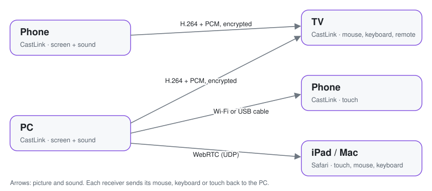

<div align="center">


# TV Launcher + CastLink

**A light home screen for Google TV, and encrypted low-latency screen casting<br>from your phone or PC to the TV, from the PC to a phone, or to an iPad or a Mac.**


[**⬇️ Download**](../../releases/latest) &nbsp;·&nbsp; [Install guide](dist/INSTALL.md) &nbsp;·&nbsp; [Launcher](docs/launcher.md) &nbsp;·&nbsp; [Screen cast](docs/screen-cast.md) &nbsp;·&nbsp; [iPad & Mac](docs/ipad.md) &nbsp;·&nbsp; [Wireless Display Receiver](https://github.com/p3perLTU/wireless-display-receiver) &nbsp;·&nbsp; [Development](docs/development.md)

</div>

---

## ✨ What's inside

<table>
<tr>
<td width="33%" valign="top">

### 🏠 TV Launcher
A home screen instead of Google TV.

- 🕒 Greeting, big clock, date
- 🌦️ Weather, 4-day forecast, any city
- 🧩 Two 2×2 blocks of your apps; hold **OK** to change or move a tile
- 🌊 Waves, your photo or a looping **video** as background
- 🌗 Text adapts to light or dark backgrounds
- 🪶 ~20 MB of memory, no ads, no tracking

</td>
<td width="33%" valign="top">

### 📡 CastLink → TV / phone
Your phone or PC screen on the TV, or the PC on your phone.

- ⚡ **~60 ms** from capture to the TV screen
- 🔐 **Encrypted**, a one-time 6-digit code pairs each new device
- 🖱️ A mouse and keyboard on the TV control the PC, with an **own pointer** that leaves the PC's mouse free
- 🔢 Type with the remote's number keys, like an old phone
- 📱 PC → phone with touch control; over the **USB cable at 120 frames/s**
- 🖥️ Windows open on the screen you clicked from
- 🎮 Switches the TV to **Game** picture mode; sound included
- 🔍 Finds the TV by itself; home network only, no open router ports

</td>
<td width="33%" valign="top">

### 📲 CastLink → iPad / Mac
The PC on an iPad or a Mac, in Safari.

- 🚀 **WebRTC over UDP**, lost packets sent again
- 👆 Touch, mouse or keyboard controls the PC (Magic Keyboard and a Mac's keyboard type directly)
- 🔐 HTTPS with the PC's own certificate: the screen stays on
- 📱 Full screen as a home-screen app
- 🖥️ Or as a **[second screen](#️-second-screen-virtual-display)** of the PC (with a virtual display driver), also on the TV and an Android phone
- 🖼️ Illustrated one-time setup on the page, for iPad and for Mac
- 📦 Nothing to install on the iPad or Mac

</td>
</tr>
</table>

## 📦 The apps

| | App | Runs on | Release file |
|:-:|---|---|---|
| 🏠 | **TV Launcher** | Android TV / Google TV 8+ | `TVLauncher-<version>.apk` |
| 📺 | **CastLink** for the TV (receiver) | Android TV / Google TV 11+ | `CastLink-TV-<version>.apk` |
| 📱 | **CastLink** for the phone (sender, and receiver for the PC) | Android phone 10+ | `CastLink-Phone-<version>.apk` |
| 💻 | **CastLink** for the PC (sender, also to the iPad and Mac) | Windows 10/11, 64-bit, portable | `CastLink-PC-<version>.zip` |
| 📲 | iPad / Mac viewer | Safari on iPadOS 13+ or macOS (16.4+ keeps the screen on) | — served by the PC app |

> [!TIP]
> Just want to use them? Take the files from the [**latest release**](../../releases/latest)
> and follow [INSTALL.md](dist/INSTALL.md). Nothing to build. A new version installs over
> the old one and keeps the settings.

## 🔧 How it works

<p align="center"></p>

Hardware encoders on the phone and PC, the hardware decoder on the TV, and **no buffering
anywhere**: each frame is shown the moment it is decoded. Every packet is sealed with
AES-128-GCM under keys from an ECDH P-256 handshake; the first time two devices meet, both
screens show the same 6-digit code, and after you confirm it they remember each other.

| Measured on a Sony KD-50X80J, 5 GHz Wi-Fi, 60 fps | 📱 Phone → TV | 💻 PC → TV |
|---|:-:|:-:|
| Capture → decoded on the TV | ~31 ms | ~28 ms |
| Capture → **on screen** | **~60 ms** | **~59 ms** |
| Lost frames | 0 | 0 |

| PC → phone (Samsung S23 FE), 120 fps, PC test pattern | 📶 5 GHz Wi-Fi | 🔌 USB cable |
|---|:-:|:-:|
| Delay measured by the phone | 20–26 ms | 16–19 ms |
| Lost frames | 0 | 0 |

**Latest check (1.10, encrypted, 2026-11-14):** pairing with the code on PC → TV, PC → phone
and phone → TV, reconnect without the code, PC → TV at 1920×1080 ~50 fps and 65–77 ms to
the screen while showing real content, PC → phone 60–88 fps with 1 lost frame, 0 packets
rejected by the TV during the PC cast. The tables above were measured before encryption.

<details>
<summary><b>📲 PC → iPad / Mac in more detail</b></summary>

Press **Show on iPad / Mac** in the PC app and open the address it shows in Safari on the iPad or
the Mac (Chrome and Edge work too), type the code. Touch, mouse, trackpad and keyboard (a
Mac's, or a Magic Keyboard on the iPad) control the PC; ⌘ shortcuts stay on the iPad or Mac. Picture and sound go over **WebRTC (UDP)**: the PC keeps the last 1024 video
packets and sends a lost one again when the iPad asks (NACK), and spreads big frames out
(pacing) so a fully changed screen does not flood the Wi-Fi. Measured with every 50th packet
thrown away on purpose: 0 packets lost for good, 0 freezes. If WebRTC cannot connect, the
page falls back to the WebSocket (WebCodecs, then Media Source).

With the PC's certificate installed once (the page shows illustrated steps for the iPad and
for the Mac), it runs over HTTPS, keeps the screen on and opens full screen: from the iPad's
home screen, or on a Mac with **Add to Dock**. The certificate can only vouch for local network
addresses; the code is locked after 5 wrong tries; only private addresses are answered.
User guide: [docs/ipad.md](docs/ipad.md). Design and security: [docs/screen-cast.md](docs/screen-cast.md#pc--ipad-in-safari).

</details>

> [!NOTE]
> **120 Hz:** both senders have a **120 frames/s** option for TVs with a 120 Hz panel. On a
> 60 Hz TV (like the KD-50X80J) keep 60: there 120 only adds delay.
> [More in the screen-cast docs →](docs/screen-cast.md#120-fps)

## 🖥️ Second screen (virtual display)

The TV, the phone or an iPad / Mac can be a **second monitor** of the PC
instead of a copy of the main screen:

1. Install a virtual display driver once, for example the open-source, Microsoft-signed
   [Virtual Display Driver](https://github.com/VirtualDrivers/Virtual-Display-Driver) (MIT),
   and set it to the device's resolution (a phone in landscape: 2340×1080).
2. In Windows **Settings → Display** choose **Extend these displays**.
3. In the PC app's **Screens** page pick that screen, then cast as usual. The **Add a
   screen…** button explains the same steps and opens the driver's page.

| | What CastLink does on a second screen |
|:-:|---|
| 👆 | Touch, the TV's mouse and the phone land on that screen, also when it is left of or above the main one |
| 🪟 | A window opened by a click from the TV, phone or iPad **opens on the shown screen**; a click with the PC's own mouse keeps it on the screen clicked |
| ⌨️ | Typed text and keys go only to a window on the shown screen |
| ↩️ | When the cast of a second screen stops, its windows **move back to the main screen** (same place, maximised ones stay maximised) |
| ⚡ | On a laptop with two graphics cards the PC app asks once to use the fast one for the second screen (NVIDIA encoder: 95–113 frames/s instead of ~75) |
| 📏 | The phone gets its own resolution (2340×1080 instead of a 16:9 picture); measured over Wi-Fi with real content: ~60 fps, 44–80 ms |

More: [docs/ipad.md](docs/ipad.md#as-a-second-screen).

## 🎨 One look everywhere

The TV app, the phone app, the PC window and the iPad / Mac page share one design: a near-black
background with a blue and a violet glow, frosted-glass cards, blue-violet buttons and the
CastLink icon (drawn in code: `cast/pc/AppIcon.cs`, `cast/*/res/drawable/icon_*.xml`,
`cast/ui/src/lt/tvcast/ui/Look.java`). The PC window follows the **Windows light or dark mode
and accent colour**, live.

## 🔒 Security and privacy

Everything stays on your home network: no account, no cloud, no internet server, no
tracking, and nothing opens a port on the router (no UPnP).

| | Protection |
|:-:|---|
| 🏠 | **Home network only:** the TV app and the PC's iPad / Mac server answer private IPv4 addresses only; WebRTC offers and accepts only home-network addresses and streams only once the connected address really is one |
| 🔢 | **Pairing code** for the iPad / Mac: 6 digits, at most one try every 2 s, after 5 wrong codes a 5-minute lock and a new code |
| 🔐 | **Encryption:** WebRTC picture and sound always (DTLS-SRTP); the page over HTTPS with the PC's own certificate authority, which can only vouch for local addresses (Name Constraints), its key protected by Windows (DPAPI) |
| 🛡️ | **Web protections:** DNS-rebinding and other-site checks (`Host`, `Origin`), CSP and no framing, at most 24 connections, size limits on every message |
| ⌨️ | **Remote control is limited:** mouse, characters and editing / navigation keys only; no Windows key, no Alt, no shortcuts; Windows keeps injected input away from admin (UAC) prompts; switch it off with one tick |
| 🔒 | **Encrypted casts:** picture, sound, typed text and mouse go AES-128-GCM sealed with keys from an ECDH P-256 handshake; a one-time 6-digit code pins each new device (no one in the middle), replayed or changed packets are dropped, old unencrypted versions are refused |
| 📺 | **One sender at a time:** during a cast the TV only accepts packets from the device that started it |
| 📦 | **Libraries:** the PC app's WebRTC libraries are checked against the NuGet catalog and against SHA-512 hashes pinned in this repository |
| 🔑 | **Signing:** every release APK is signed with the same release key, kept outside the repository with a DPAPI-protected password; `release.ps1` scans every file for addresses, e-mails and keys before uploading |

> [!NOTE]
> The phone / PC → TV and PC → phone casts are **encrypted** (ECDH P-256 + AES-128-GCM). The
> first time two devices meet, both show the same 6-digit code; after you confirm it they
> remember each other. Turn **USB / wireless debugging** off on the TV and the phone when you
> do not need it.

The full threat table and what was attacked live: [docs/screen-cast.md](docs/screen-cast.md#security-model), and for the iPad / Mac server [its own table](docs/screen-cast.md#https-keeping-the-ipad-screen-on).

## 🧪 Tests

```powershell
.\tests\run-tests.ps1
```

| Suite | Tests | What |
|---|:-:|---|
| ☕ Java | 75 | Wire format, frame reassembly (loss, reordering, sender restart), **encryption** (handshake, tampered and replayed packets, points off the curve, other keys), TV mouse and keyboard, typing with the remote, touch → PC, launcher grid, logo recolouring, weather codes |
| #️⃣ C# | 70 | **Encryption: the same golden keys, code and sealed bytes as the Java side**, protocol bytes, colours, mDNS, settings, USB cable route and firewall script, typing only on the shown screen, windows moved back, picture size, input decoding; iPad server: MP4, HTTP / WebSocket, DNS-rebinding and code-guessing protection, certificate, WebRTC filters, RTP, NACK |
| 📲 iPad / Mac page | 30 | The page's JavaScript **in headless Chrome or Edge**: touch → PC coordinates, input bytes, jitter buffer, sound buffer, MP4 reading, setup guides and drawings (iPad, Mac), physical keyboard |
| 📜 PowerShell | all | Every script parses |

`release.ps1` runs them before every release. More: [docs/development.md](docs/development.md#tests),
[docs/ipad.md](docs/ipad.md#tests).

## 🚀 Build from source

No Gradle: the APKs are built with the Android SDK build tools directly (no third-party
libraries), the PC app with the C# compiler that ships with Windows. The PC app's WebRTC
libraries are fetched from NuGet and checked by hash on the first build
(`cast\pc\restore-packages.ps1`).

```powershell
.\build.ps1                       # TV Launcher      -> build\tvlauncher.apk
.\cast\build.ps1 -App receiver    # CastLink, TV     -> cast\receiver\build\receiver.apk
.\cast\build.ps1 -App sender      # CastLink, phone  -> cast\sender\build\sender.apk
.\cast\pc\build.ps1               # CastLink, PC     -> cast\pc\build\CastLink.exe
.\tests\run-tests.ps1             # 175 tests
```

Run the scripts with `powershell -ExecutionPolicy Bypass -File <script>`. Requirements,
the signing key and the release process: [docs/development.md](docs/development.md).

## 📚 Documentation

| | Document | What's in it |
|:-:|---|---|
| 📥 | [dist/INSTALL.md](dist/INSTALL.md) | Installation, for people who only get the release files |
| 🏠 | [docs/launcher.md](docs/launcher.md) | Using the launcher, making Home open it on Google TV, recovery after a firmware update, undo |
| 📡 | [docs/screen-cast.md](docs/screen-cast.md) | Using the cast, design, protocol, measured latency, WebRTC, security model |
| 📲 | [docs/ipad.md](docs/ipad.md) | iPad and Mac user guide: setup, controls, info line, troubleshooting, tests |
| 🖥️ | [Wireless Display Receiver](https://github.com/p3perLTU/wireless-display-receiver) | A separate, public project: a Miracast / Samsung DeX wireless receiver for the TV (its own repository, build and tests) |
| 🛠️ | [docs/development.md](docs/development.md) | Requirements, building, signing, tests, releases, code layout |

<details>
<summary><b>🗂️ Repository layout</b></summary>

```
AndroidManifest.xml, src/, res/, assets/   TV Launcher
cast/common/src/                           protocol, encryption (SecureLink), frame assembly, input: shared by the TV and phone apps
cast/ui/src/                               the shared CastLink look (Android)
cast/receiver/                             CastLink for the TV
cast/sender/                               CastLink for the phone
cast/pc/TVCastPC.cs                        CastLink for the PC: capture, encoder, sound, TV cast, window
cast/pc/SecureLink.cs                      encryption and pairing (same format as the Android side)
cast/pc/WindowMover.cs, UsbRoute.cs        windows follow the clicking device; the phone's USB cable route
cast/pc/AppIcon.cs                         the CastLink icon, drawn in code
cast/pc/WebCast.cs, Fmp4.cs, RemoteInput.cs iPad mode: web server, MP4 fragments, touch -> mouse/keyboard
cast/pc/WebRtc.cs                          iPad mode: WebRTC (UDP) with packet resend and pacing
cast/pc/LocalTls.cs                        iPad mode: the PC's own certificate authority for HTTPS
cast/pc/web/ipad.html                      the iPad / Mac page (embedded in the exe)
cast/pc/restore-packages.ps1               fetches the WebRTC libraries (NuGet, hash-checked) into cast/pc/lib
tests/                                     Java, C# and iPad-page tests, tests/run-tests.ps1
docs/                                      documentation
dist/INSTALL.md                            end-user install guide (release files go next to it)
*.ps1                                      build, install, recovery and release scripts
```

</details>

<details>
<summary><b>📜 Scripts</b></summary>

| Script | What it does |
|---|---|
| `build.ps1` | Builds `build\tvlauncher.apk` |
| `cast\build.ps1 -App receiver\|sender` | Builds `cast\<app>\build\<app>.apk` |
| `cast\pc\build.ps1` | Builds `cast\pc\build\CastLink.exe` |
| `tests\run-tests.ps1` | Runs all tests |
| `install.ps1` | Installs the launcher on the connected TV and grants its permissions |
| `after-update.ps1 [-Ip <TV IP>] [-DryRun]` | Restores the setup after a firmware update or factory reset |
| `undo.ps1` | Gives Home back to Google TV and uninstalls the launcher |
| `screenshot.ps1 <name>` | Saves a TV screenshot as `<name>.png` |
| `cast\measure.ps1 -Phone <serial>` | Scrolls the phone and averages the receiver's latency statistics |
| `release.ps1 -Version X.Y [-Notes "..."] [-DryRun]` | Tests, builds, checks and publishes a GitHub release |

Scripts that talk to the TV take its address as `-Ip`, or read it from `tv-ip.txt` (one
line, git-ignored, so the address never ends up in the repository).

</details>

<details>
<summary><b>🌍 Languages</b></summary>

All apps are in **English**, and in **Lithuanian** when the device is set to Lithuanian:

- Android apps: `res/values` (English) and `res/values-lt` (Lithuanian). Add a language by
  copying `values` to `values-<code>` and translating.
- PC app: the `Texts` class in `cast/pc/TVCastPC.cs`; `--lang en|lt` forces one.
- iPad / Mac page: the `T` texts at the top of `cast/pc/web/ipad.html`, picked by the browser's language.

</details>

## ⚖️ Licence

The code is under the [**MIT License**](LICENSE): use, change and share it freely, keeping
the copyright notice. Third-party parts keep their own licences:

- Font: [Outfit](https://github.com/Outfitio/Outfit-Fonts), SIL Open Font License
  ([assets/fonts/Outfit-OFL.txt](assets/fonts/Outfit-OFL.txt)).
- Icons: Google Material Symbols / Material Icons, Apache License 2.0
  ([licenses/Material-Symbols-Apache-2.0.txt](licenses/Material-Symbols-Apache-2.0.txt)).
- PC app, WebRTC: [SIPSorcery](https://github.com/sipsorcery-org/sipsorcery) and 25 libraries
  it needs (MIT, Apache-2.0, BSD-2/3-Clause), not in the repository but shipped in the `lib`
  folder of the PC zip with `lib\THIRD-PARTY-NOTICES.md` and their licence texts.

> [!IMPORTANT]
> SIPSorcery's licence is BSD-3-Clause **plus an additional use restriction**: it must not
> be used, modified or distributed inside Israel and the Occupied Territories. This applies
> to the PC app's `lib` folder; without it the PC app still works, only without WebRTC.
